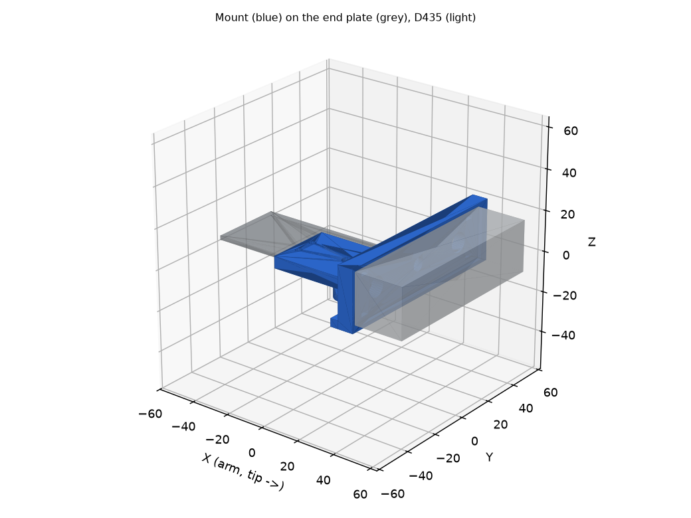

# Camera mount: RealSense D435 on the front of the arm

3D model (parametric, printable) of a bracket that carries the D435 at the **front of the arm**, plus a
holder for the suction nozzle. Source: [`cad/camera_mount.py`](../cad/camera_mount.py); print file:
[`cad/camera_mount.stl`](../cad/camera_mount.stl); assembly with a plate stub and a camera mock-up:
[`cad/camera_mount_assembly.stl`](../cad/camera_mount_assembly.stl) (for a viewer, not for printing).



## What the photos show

- The forearm ends in a **horizontal flat plate** (the levelling wrist keeps it level at every pose), carried
  by a triangular gusset and two vertical side plates, with brass hex standoffs behind it.
- The plate has a **rectangular window ~40 x 20 mm** with **4 small holes** (two at each end of the window):
  the pattern of a standard servo bracket (MG996R: 49.5 x 10 mm). The window is on the arm's axis, with the long
  side along the arm. The plate's front edge is ~32 mm in front of the window centre, and about 36 mm wide.
- The D435 is 90 x 25 x 25 mm with a **1/4-20 tripod thread in the middle of its bottom face** and a USB-C
  connector on one short end.
- The brass standoffs sit ~10 mm above the plate: there is room for bolt heads on top of the plate.

These dimensions come from the photos (scale taken from the 20 x 40 mm window), so they are good to a
millimetre or two, not better: see **Check before printing**.

## The design

```
          side view (arm to the left, tip to the right)

  ======== plate (2) =========[ window ]===========+
          | printed block (6) under the plate      |#| wall (8) in front of the plate edge
          +----------+---------+------------------+#|----[ D435 ]----   <- lens face looks DOWN
                     | boss (nozzle holder)         |
                     | tube / cup stem
```

- **Block** (34 x 61 x 6 mm) under the plate, bolted through the 4 plate holes (M3 bolts from the top, nuts in
  hexagonal pockets on the underside). The pull of the camera's weight is resisted by the holes 49.5 mm apart.
- **Wall** (98 x 8 mm) right in front of the plate edge. The camera's **bottom face** is bolted to it with the
  1/4-20 screw, turned so that its **lenses look straight down** (the plate is always level, so the camera
  always looks straight down). A shallow pocket (90.6 x 25.6 x 2 mm) stops it rotating. The camera ends up with
  its long axis across the arm and the lens face 4 mm below the plate.
- **Nozzle holder**: a 6.4 mm bore with a 14 mm boss through the block, exactly under the plate window
  (the window is the opening for the tube going up to the pump), with an M3 set screw to clamp the stem.
  Adapt the bore when the suction cup is chosen ([`GRIPPER.md`](GRIPPER.md)).
- Four cable-tie slots (both wings, so the USB-C end can face either side) and lightening holes in the wings.
- Printed part: 31 cm^3, about **22 g** with 40% infill (PETG). Total added load about 110 g (camera 72 g, bolts).

### Why the camera is *in front of* the nozzle

- The **nozzle sits ~51 mm behind the camera centre**, 47 mm lower than the lens face. Seen from the lens the
  nozzle is 47 deg off the vertical (the depth stream sees +-29 deg along the arm), so it is **never in the
  picture** and does not occlude coins. The picture still contains the spot under the nozzle (about 106 px
  behind the image centre at 30 cm height): `--calibra` learns that pixel.
- The camera stays **above the pile**: while the nozzle touches a coin the lens is ~50 mm above the table.
- The window region of the plate is used by the nozzle, so there is nowhere else to put the camera (behind the
  window are the standoffs and side plates).
- Rejected: camera on top of the arm tilted forward (the image would no longer be straight down, which the pixel
  model likes); camera behind the nozzle (hangs in the middle of the structure); a long mast (moment on the
  shoulder, which already stalls at full extension).

## Check before printing (calipers, 2 minutes)

All of these are variables at the top of `cad/camera_mount.py`; change them and run `python cad/camera_mount.py`.

| Measure | Value used | Note |
|---------|-----------|------|
| Hole pattern, along the arm (`HOLES_DX`) and across (`HOLES_DY`) | 49.5 x 10 | the photo says 47-49.5 along |
| Hole diameter (`BOLT`) | M3 | the holes look **2.6-3 mm**: if they are 2.6 use M2.5 (`BOLT = 2.5`) or drill them to 3.2 |
| Plate thickness (`PLATE_T`) | 2.0 | only used for the previews |
| Plate front edge from the window centre (`PLATE_EDGE_X`) | 32 | decides where the wall stands: it must be *just in front* of the edge |
| Plate width (`PLATE_HALF_W`) | 18 | the block is 34 wide; it must stay inside the plate |
| Window (`WINDOW`) | 40.6 x 20.2 | the bore must stay under it |
| D435 | 90 x 25 x 25, thread 1/4-20 | check the thread depth (about 6 mm) to choose the screw length |
| Space above the plate behind the wall | | the screw head (12 mm) sits there, it needs a hand/driver |

## Bill of materials

- 1 printed part (PETG or ABS, 5 perimeters, 40% gyroid; print it **lying on the wall's rear face**, the camera
  load is shear along the layers; or upright with supports under the boss).
- 4 x M3 x 8-10 bolts (cap or button head, in from the **top** of the plate) + 4 x M3 nuts (in the pockets).
- 1 x 1/4-20 UNC bolt, **12-13 mm** long, + a washer (the camera holds the thread).
- 1 x M3 x 8 set screw + 1 nut (nozzle clamp).
- 4 cable ties. A short, good **USB 3 cable** (a bad one drops the D435 to USB2: 6 fps, noisy depth).

## Assembly

1. Slide the 4 nuts into the pockets on the underside of the block.
2. Hold the block under the plate, wall in front of the edge, and put the 4 bolts through the plate from the top.
3. Put the 1/4-20 bolt through the wall (head recess on the rear side) into the camera's bottom thread, lens down.
4. Run the USB cable along the arm with the ties.
5. **Redo the calibrations** (below).

## What changes in the software

- The image is now landscape with its long side across the arm. `center_coin.py` relearns the pixel Jacobian
  by itself on every run, so nothing to change.
- **Redo `python3 tools/center_coin.py --calibra`** (and delete the old `camera_calib.json` / `nozzle_calib.json`):
  the camera moved relative to the tool. It learns the nozzle pixel and the **touch height**, which will be about
  +50 mm (the nozzle hangs ~51 mm below the plate underside; the exact value depends on where the old tool point was).
- **Reach improves a lot.** Until now the tool point had to go down to the coin surface (Z about -10), reachable only
  between 29 and 37 cm from the base. With the nozzle hanging 51 mm below the plate, the plate only has to reach
  Z about +45, reachable up to about 43 cm (see the table in [`PICKING.md`](PICKING.md)).
- The kinematic model (`domain/kinematics.py`, `D` = vertical offset, `TOOL_REACH_MM`) describes the old tool point:
  for exact `move_to` of the nozzle, lower `D` by the nozzle length and shift `TOOL_REACH_MM` by its X offset, or just
  rely on the learned touch height (what `center_coin.py` does).
- Added load about 110 g, 0.35-0.5 m from the shoulder, which already stalls at full extension: keep the part light, and
  if the shoulder complains lower `SHOULDER_MAX_DEG`.

## Open points

- The nozzle bore, boss and set screw are a placeholder until the suction cup and its stem are chosen.
- If the plate holes are not usable, a clamp version (two printed halves gripping the plate edges) is a small change.
- A 10-15 degree forward tilt would show more of the table ahead of the arm; not worth losing the straight-down view yet.
